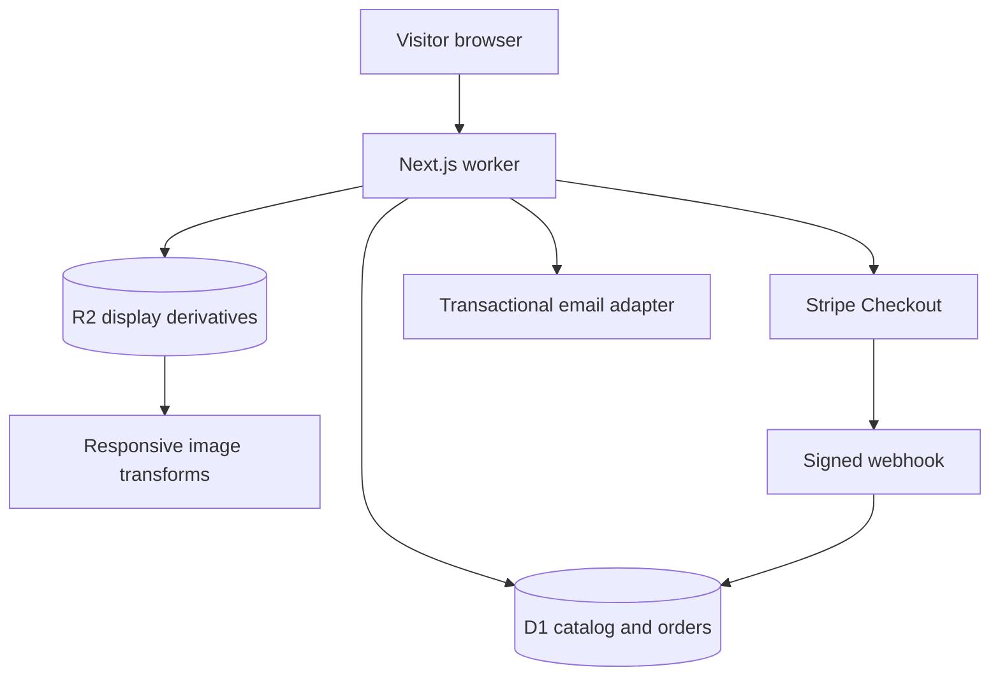

# Architecture

## Runtime shape

Memories with Mike is a server-first Next.js App Router application compiled by Vinext to a Cloudflare Worker. Public pages query D1 through a request-scoped binding. Protected display derivatives live in R2 and are transformed by Cloudflare Images at approved widths. Client components are limited to interactions such as the cart, favorites, filters, lightbox, forms, consent, and administrator editors.

Original master photographs never enter this system. The upload workflow accepts administrator-prepared JPEG, PNG, WebP, or AVIF derivatives up to 20 MB, validates dimensions and file signatures, creates a randomized object key, and stores a SHA-256 checksum.

## Major boundaries

| Boundary       | Implementation                              | Important guarantee                                                                |
| -------------- | ------------------------------------------- | ---------------------------------------------------------------------------------- |
| Public catalog | lib/catalog.ts                              | Published and visible records only; polished static fallback before content launch |
| Pricing        | lib/commerce.ts                             | Variant price is resolved again on the server in integer cents                     |
| Payments       | app/api/checkout and app/api/stripe/webhook | Stripe signatures, idempotency keys, event ledger, immutable order-item snapshots  |
| Administration | app/admin and app/api/admin                 | Host identity plus exact email allowlist on every page and mutation                |
| Images         | lib/storage.ts and app/media                | Display derivatives only, randomized keys, downscaled AVIF/WebP/JPEG responses     |
| Email          | lib/email.ts                                | Provider-neutral messages, escaped dynamic HTML, local preview logging             |
| Fulfillment    | lib/fulfillment.ts                          | Manual provider works now; Order Desk and Bay Photo are isolated typed stubs       |
| Analytics      | lib/analytics.ts and AnalyticsProvider      | None by default, Plausible option, consent-gated Google option, disabled in admin  |

## Data model

db/schema.ts defines 32 D1 tables with foreign keys, indexes, unique constraints, timestamps, status enums, and soft-deletion fields where appropriate.

Identity and access:

- users
- accounts
- sessions
- audit_logs

Photography and curation:

- categories
- photographs
- photograph_assets
- collections
- collection_photographs
- redirects

Commerce:

- products
- product_variants
- materials
- sizes
- finishes
- frames
- carts
- cart_items
- favorites
- discounts

Customers and orders:

- customers
- addresses
- orders
- order_items
- payments
- webhook_events
- fulfillments

Content and communication:

- inquiries
- journal_posts
- newsletter_subscribers
- site_settings
- faqs

Every order item stores product name, photograph title, SKU, selected-option JSON, unit price, discount, tax, and total snapshots. Catalog changes therefore do not rewrite order history.

## Content configuration

The homepage reads its hero slug, title, location, statement, signature story, featured collection, and section visibility from the homepage site setting. Brand fields, navigation order, social links, optional service starting prices, commerce status, maintenance mode, and fulfillment selection are also editable in /admin/settings.

Static content in lib/content.ts is a deliberate pre-launch fallback. Hosted seed records are drafts and inactive. Once a real record is published, catalog queries return database content. This keeps the site visually complete without creating a purchasable fake catalog.

## Rendering and performance

- Server components are the default.
- Interactive islands own the smallest practical state boundary.
- Every photograph sits in a stable aspect-ratio container.
- The hero is the only eager display asset.
- Uploaded derivatives receive 480, 768, 1200, 1600, and 2048 pixel AVIF/WebP/JPEG candidates.
- Gallery filters operate on already-paginated page data; the repository boundary can add cursor pagination without changing UI types.
- Public assets use immutable cache keys; administrative and customer-specific responses use no-store behavior.
- npm run bundle:report lists the largest emitted client assets.

## Authentication decision

Cloudflare Access performs the administrator sign-in challenge and injects a signed JWT. The Worker verifies the JWT issuer, audience, signature, and email claim against Cloudflare's published keys, then performs its own exact, case-insensitive `ADMIN_EMAIL_ALLOWLIST` authorization on every protected page and API mutation. No administrator password or reusable bearer token is committed or generated.

## PostgreSQL, Prisma, and Vercel portability

The deployed application intentionally uses D1 and Drizzle, not PostgreSQL and Prisma, because Cloudflare provides D1/R2 bindings close to the Worker runtime. The domain boundaries are portable, but a Vercel migration is not a configuration-only change:

1. Replace db/schema.ts with a PostgreSQL schema and generated migration history.
2. Replace D1 prepared statements in repository and administrative services with a PostgreSQL adapter.
3. Replace request-scoped DB/R2/Images bindings with Node-compatible clients.
4. Add Auth.js and its persistent session adapter if host-provided identity is unavailable.
5. Replace the R2 binding adapter with an S3 SigV4 client.
6. Re-run integration, webhook, and end-to-end tests against the target platform.

The S3CompatibleStorageAdapter and fulfillment interfaces mark those seams without fabricating an unverified production integration.

## Caching and invalidation

This release favors correctness over opaque caching. Public database reads happen server-side, while immutable image derivatives are cached at the edge. A future high-volume deployment can wrap catalog reads in tagged cache functions and invalidate tags after the existing admin mutation points. Do not cache administrator identity, cart state, inquiry submission, checkout, order lookup, or webhook handling.
